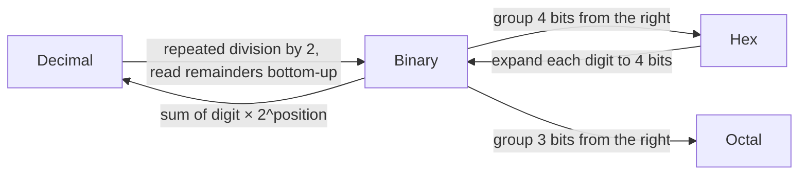

Computers store everything as **bits** (0 or 1). Humans find long strings of bits hard to read, so
assembly programmers mostly use **hexadecimal**, where one hex digit stands for exactly four bits
(one *nibble*, see [Memory](../registers-memory/memory.html)).

## Positional notation

In any base *b*, a digit's value is the digit multiplied by *b* raised to its position (counting from 0 on the right):

| Base | Name | Digits | Example | Value |
|---|---|---|---|---|
| 2 | Binary | 0 1 | `1011b` | 1·2³ + 0·2² + 1·2¹ + 1·2⁰ = **11** |
| 8 | Octal | 0-7 | `13o` | 1·8¹ + 3·8⁰ = **11** |
| 10 | Decimal | 0-9 | `11` | **11** |
| 16 | Hexadecimal | 0-9, A-F | `0Bh` | 11·16⁰ = **11** |

## Converting between bases



### Decimal → binary (repeated division)

Convert **200** to binary: divide by 2 and keep the remainders.

| Division | Quotient | Remainder |
|---|---|---|
| 200 ÷ 2 | 100 | 0 |
| 100 ÷ 2 | 50 | 0 |
| 50 ÷ 2 | 25 | 0 |
| 25 ÷ 2 | 12 | 1 |
| 12 ÷ 2 | 6 | 0 |
| 6 ÷ 2 | 3 | 0 |
| 3 ÷ 2 | 1 | 1 |
| 1 ÷ 2 | 0 | 1 |

Reading the remainders from the bottom up gives **1100 1000b**. The same method with 16 as the divisor gives hex directly: 200 = 12·16 + 8 → **C8h**.

### Binary ↔ hexadecimal (grouping)

Group bits in fours from the right; each group is one hex digit:

```text
1010 1111 0011 0110b
   A    F    3    6   →  0AF36h
```

| Hex | Binary | Hex | Binary | Hex | Binary | Hex | Binary |
|---|---|---|---|---|---|---|---|
| 0 | 0000 | 4 | 0100 | 8 | 1000 | C | 1100 |
| 1 | 0001 | 5 | 0101 | 9 | 1001 | D | 1101 |
| 2 | 0010 | 6 | 0110 | A | 1010 | E | 1110 |
| 3 | 0011 | 7 | 0111 | B | 1011 | F | 1111 |

## Try it

:::widget number-converter
Number converter, type in any box; the others update. It also shows the value as an 8/16/32-bit pattern and its signed (two's complement) meaning.
:::

## Writing numbers in assembly (MASM/TASM syntax)

```asm
mov al, 200        ; decimal (default radix)
mov al, 0C8h       ; hexadecimal: suffix h, must start with a digit (0C8h, not C8h)
mov al, 11001000b  ; binary: suffix b
mov al, 310o       ; octal: suffix o or q
mov al, 'A'        ; character: the assembler stores its ASCII code, 41h
```

:::warning
A hex constant that begins with a letter needs a leading `0`, otherwise the assembler reads it as a
name: `mov ax, FFFFh` is an error (undefined symbol), `mov ax, 0FFFFh` is correct.
:::

## Sources

- Intel, *The 8086 Family User's Manual* (Oct. 1979), ch. 2, data types, [archive.org](https://ia801302.us.archive.org/2/items/bitsavers_intel80869lyUsersManualOct79_62967963/9800722-03_The_8086_Family_Users_Manual_Oct79.pdf)
- Microsoft Learn, *MASM: Directives reference / radix and constants*, [learn.microsoft.com](https://learn.microsoft.com/en-us/cpp/assembler/masm/directives-reference)
- Wikipedia, *Hexadecimal*, [en.wikipedia.org/wiki/Hexadecimal](https://en.wikipedia.org/wiki/Hexadecimal)
- K. Irvine, *Assembly Language for x86 Processors*, ch. 1.3 “Data Representation”.
