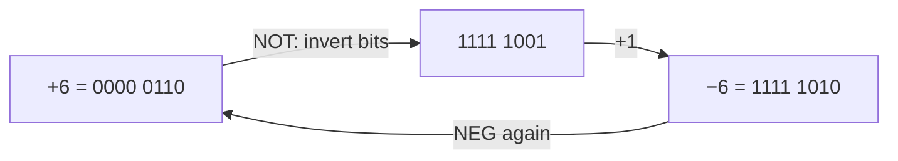

The same bit pattern can mean different things. `1111 1111b` (0FFh) is **255** if you treat it as
*unsigned* and **−1** if you treat it as *signed*. The CPU doesn't know which one you mean. The
instructions you choose (e.g. `JA` vs `JG`, `MUL` vs `IMUL`) and the flags you test say which one.

## Integer sizes and ranges

| Type | Bits | Unsigned range | Signed range (two's complement) |
|---|---|---|---|
| Byte | 8 | 0 … 255 | −128 … +127 |
| Word | 16 | 0 … 65,535 | −32,768 … +32,767 |
| Double word | 32 | 0 … 4,294,967,295 | −2,147,483,648 … +2,147,483,647 |

## Two's complement

Signed numbers on the 8086 use **two's complement**. The most significant bit (MSB) is the **sign bit**: 0 = positive, 1 = negative.

To negate a number: **invert every bit, then add 1** (this is exactly what the `NEG` instruction does).

```text
 +6  = 0000 0110
 invert 1111 1001
 add 1  +       1
 −6  = 1111 1010   = 0FAh
```



Why it works: adding a number and its two's complement gives 2ⁿ, which overflows to 0 in n bits. So
the same adder circuit handles signed and unsigned addition. That is one reason the
[ALU](../processor/instruction-cycle.html) does not need separate hardware for signed math.

## Carry vs. overflow

| Flag | Meaning | Relevant when the numbers are… |
|---|---|---|
| **CF** (carry) | Result did not fit as an *unsigned* number (carry/borrow out of the MSB) | unsigned |
| **OF** (overflow) | Result did not fit as a *signed* number (sign changed incorrectly) | signed |

```asm
mov al, 0FFh   ; 255 unsigned, -1 signed
add al, 1      ; AL = 00h, CF = 1 (unsigned 256 doesn't fit), OF = 0 (-1 + 1 = 0 is fine)

mov al, 7Fh    ; +127
add al, 1      ; AL = 80h, CF = 0, OF = 1 (+128 doesn't fit in a signed byte; it looks like -128)
```

## Sign extension

To widen a signed value, copy the sign bit into the new high bits: `0FAh` (−6) as a word is
`0FFFAh`. The 8086 provides `CBW` (AL → AX) and `CWD` (AX → DX:AX). For unsigned values, zero-extend
instead (e.g. `mov ah, 0`).

```asm
mov al, -6     ; AL = 0FAh
cbw            ; AX = 0FFFAh  (still -6)
cwd            ; DX:AX = 0FFFFh:0FFFAh  (still -6, ready for IDIV)
```

## Characters: ASCII

Characters are stored as numeric codes. The common ones in assembly programs:

| Characters | Codes (hex) | Useful trick |
|---|---|---|
| `'0'` … `'9'` | 30h … 39h | digit value = code − 30h (`sub al, '0'`) |
| `'A'` … `'Z'` | 41h … 5Ah | lowercase = uppercase + 20h (`or al, 20h`) |
| `'a'` … `'z'` | 61h … 7Ah | uppercase = lowercase − 20h (`and al, 0DFh`) |
| space | 20h | |
| CR, LF | 0Dh, 0Ah | new line on DOS = CR LF |
| `'$'` | 24h | string terminator for DOS function 09h |

## BCD (binary-coded decimal)

BCD stores one decimal digit per nibble: 59 decimal → `0101 1001b` = `59h` (packed BCD). The 8086
supports it with `DAA`/`DAS` (packed) and `AAA`/`AAS`/`AAM`/`AAD` (unpacked). The Auxiliary-carry flag
**AF** described in the [flag register](../registers-memory/types-of-registers.html#flag-register) exists to support these adjustments.

## Sources

- Wikipedia, *Two's complement* — [en.wikipedia.org/wiki/Two%27s_complement](https://en.wikipedia.org/wiki/Two%27s_complement)
- Wikipedia, *ASCII* — [en.wikipedia.org/wiki/ASCII](https://en.wikipedia.org/wiki/ASCII)
- Wikipedia, *FLAGS register* — [en.wikipedia.org/wiki/FLAGS_register](https://en.wikipedia.org/wiki/FLAGS_register)
- Intel, *The 8086 Family User's Manual* (1979), ch. 2 — data types, arithmetic and flags — [archive.org](https://ia801302.us.archive.org/2/items/bitsavers_intel80869lyUsersManualOct79_62967963/9800722-03_The_8086_Family_Users_Manual_Oct79.pdf)
