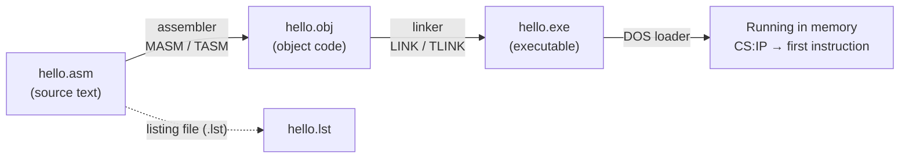
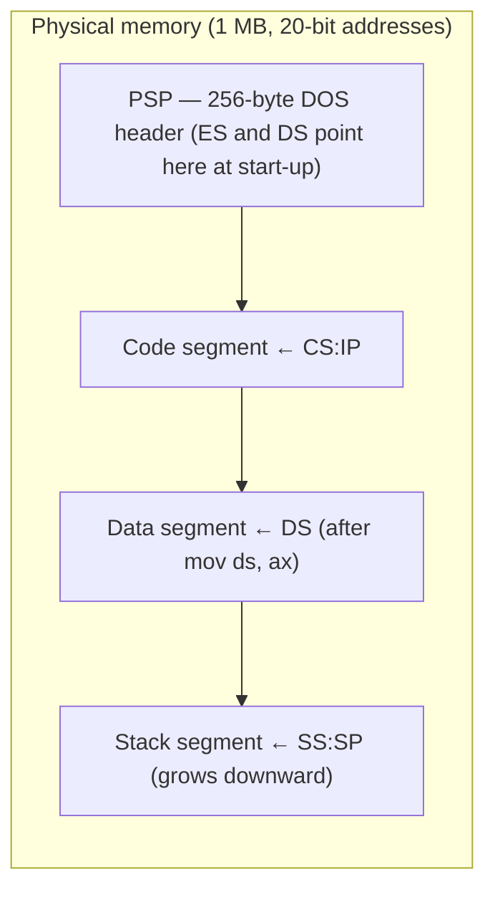

The course slides describe *what* the CPU does with machine instructions (the
[instruction cycle](../processor/instruction-cycle.html)). This page shows how you produce those
instructions from an assembly-language source file.

## From source to execution



- **Assembler** translates each mnemonic into machine code (opcode + operands), resolves labels within the file and reports syntax errors.
- **Linker** combines object files, resolves references between them and produces the `.exe` header that tells DOS how large each segment is.
- **Loader** (part of DOS) reads the `.exe`, picks free memory, sets the segment registers (CS, SS) and the instruction pointer IP, and starts the program.

## Anatomy of a program (simplified segment directives)

```asm
.model small          ; memory model: one code segment, one data segment (each ≤ 64 KB)
.stack 100h           ; reserve 256 bytes for the stack segment

.data                 ; ---- data segment: variables ----
msg  db 'Hello, COAL!', 0Dh, 0Ah, '$'

.code                 ; ---- code segment: instructions ----
main proc
    mov ax, @data     ; @data = segment address of .data
    mov ds, ax        ; DS must point at our data (can't MOV an immediate into DS)

    mov ah, 09h       ; DOS function 09h: print '$'-terminated string at DS:DX
    lea dx, msg
    int 21h

    mov ax, 4C00h     ; DOS function 4Ch: terminate with return code 0
    int 21h
main endp
end main              ; end of source; 'main' is the entry point
```

| Part | Purpose |
|---|---|
| `.model small` | Chooses a memory model. *tiny* = code+data in one 64 KB segment (.COM), *small* = one code + one data segment, *medium/compact/large* = several. |
| `.stack 100h` | Size of the stack segment; SS:SP are set up by the loader. |
| `.data` | Starts the data segment ([DS](../registers-memory/registers.html#segment-registers)). |
| `.code` | Starts the code segment (CS). |
| `proc` / `endp` | Marks a procedure. |
| `end main` | Ends the source file and names the entry point (initial CS:IP). |

:::note
Why `mov ax, @data` / `mov ds, ax`? The 8086 cannot load an immediate value directly into a segment
register, so the address goes through a general-purpose register first.
:::

## How the program sits in memory



Each segment's physical address is `segment × 10h + offset`, as in
[Memory Organization & Segmentation](../registers-memory/memory-segmentation.html).

## Assembling and running

**With TASM in DOSBox:**

```text
tasm hello.asm
tlink hello.obj
hello
```

**With MASM in DOSBox:**

```text
masm hello.asm;
link hello.obj;
hello
```

**With emu8086:** open the file, press *Emulate*, then *Run* or *Single step*. emu8086 also shows registers and memory, which helps when [debugging](../advanced/debugging.html).

## Sources

- Microsoft Learn, *.MODEL (MASM)* — [learn.microsoft.com/en-us/cpp/assembler/masm/dot-model](https://learn.microsoft.com/en-us/cpp/assembler/masm/dot-model)
- Microsoft Learn, *MASM Directives reference* — [learn.microsoft.com](https://learn.microsoft.com/en-us/cpp/assembler/masm/directives-reference)
- UMBC CMSC 211, *DOS INT 21h functions* — [csee.umbc.edu](https://www.csee.umbc.edu/courses/undergraduate/CMSC211/fall01/burt/tech_help/int21.html)
- Wikipedia, *Assembly language* (assembler, linker concepts) — [en.wikipedia.org/wiki/Assembly_language](https://en.wikipedia.org/wiki/Assembly_language)
- Wikipedia, *Program Segment Prefix* — [en.wikipedia.org/wiki/Program_Segment_Prefix](https://en.wikipedia.org/wiki/Program_Segment_Prefix)
