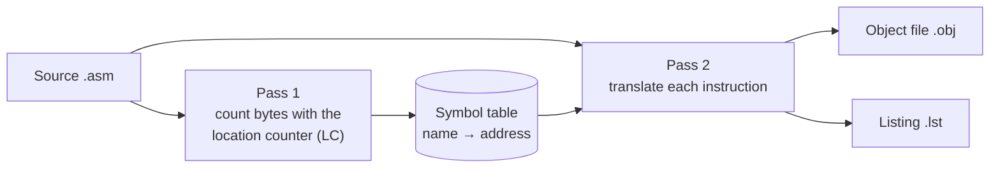
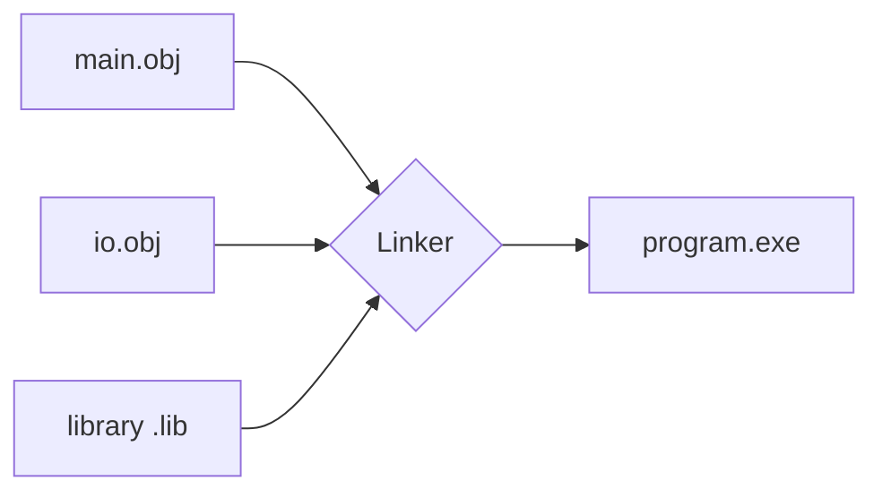

[Program Structure](program-structure.html) shows the commands that turn `hello.asm` into `hello.exe`. This
lesson explains what each tool does internally.

## Why two passes?

A program can jump **forward** to a label that has not been defined yet:

```asm
      jmp done        ; 'done' is not known yet when this line is read
      mov ax, 1
done: mov ah, 4Ch
```

A one-pass assembler cannot know the address of `done` here. The classic solution reads the source twice.



### Pass 1: build the symbol table

The assembler keeps a **location counter (LC)**, the offset of the next byte. For each line it records
labels and variables with the current LC, then adds the size of the instruction or data.

| Line | LC before | Size | Symbol recorded |
|---|---|---|---|
| `msg db 'Hi$'` | 0000 | 3 | msg = 0000 (data) |
| `count dw 5` | 0003 | 2 | count = 0003 (data) |
| `start: mov ax, @data` | 0000 | 3 | start = 0000 (code) |
| `jmp done` | 0003 | 2 | - |
| `mov ax, 1` | 0005 | 3 | - |
| `done: mov ah, 4Ch` | 0008 | 2 | done = 0008 |

### Pass 2: generate code

Now every symbol has an address, so each instruction can be [encoded](../processor/instruction-encoding.html)
completely. Undefined names produce errors (“undefined symbol”). Names declared `EXTRN` are left as
**references** for the linker to fill in.

## The object file

An `.obj` file contains the machine code and data for each segment, the **public** symbols it offers, the
**external** symbols it needs, and **relocation entries**: places whose final address depends on where the
program is loaded (for example `mov ax, @data`).

## The linker



The linker combines several object files and libraries into one program:

1. **Symbol resolution:** matches each external reference to a public symbol elsewhere.
2. **Relocation:** places all segments one after another and patches every address that depends on it.
3. Writes the executable with a header describing segment sizes and the entry point.

## The loader

The DOS loader brings the program into memory and starts it:

1. Finds free memory and builds the 256-byte **PSP** (program segment prefix).
2. Copies the program in and applies the remaining **segment relocations** using the actual load address.
3. Sets **CS:IP** to the entry point and **SS:SP** to the stack, then jumps to the program.

## .COM vs .EXE

| | .COM | .EXE |
|---|---|---|
| Size limit | one 64 KB segment for code + data + stack | several segments, up to available memory |
| Header | none, a plain memory image | “MZ” header with a relocation table |
| Start address | always offset **100h** (`ORG 100h`), after the PSP | given in the header (`END main`) |
| Segment registers at start | CS = DS = ES = SS = PSP segment | CS and SS from the header; DS = ES = PSP |
| Memory model | `.MODEL TINY` | `.MODEL SMALL` and larger |

```asm
; A minimal .COM program (assemble, then: tlink /t hello.obj)
.model tiny
.code
org 100h
start:
    mov ah, 09h
    lea dx, msg
    int 21h
    ret               ; returning to the PSP ends a .COM program
msg db 'Hello from a .COM file$'
end start
```

## Sources

- L. Beck, *System Software: An Introduction to Systems Programming*, ch. 2 “Assemblers” and ch. 3 “Loaders and Linkers”.
- Wikipedia, *Assembly language, Number of passes*, [en.wikipedia.org](https://en.wikipedia.org/wiki/Assembly_language#Number_of_passes)
- Wikipedia, *COM file*, [en.wikipedia.org](https://en.wikipedia.org/wiki/COM_file)
- Wikipedia, *DOS MZ executable*, [en.wikipedia.org](https://en.wikipedia.org/wiki/DOS_MZ_executable)
