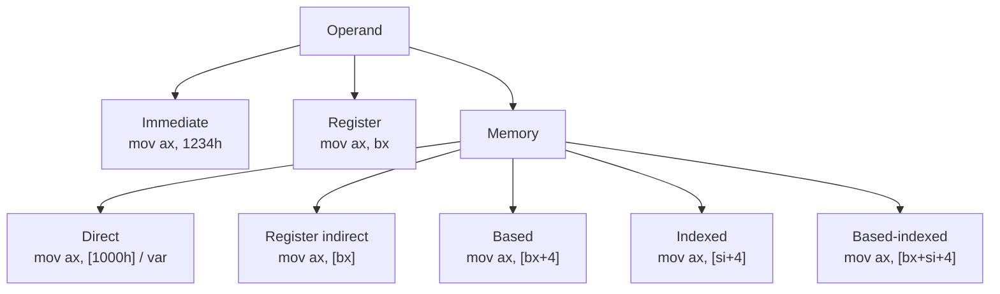

An **addressing mode** is the way an instruction specifies where its operand is. The
[CISC vs RISC](../processor/cisc-vs-risc.html) page notes that CISC designs such as the 8086 provide
many addressing modes. Here they are.

## Overview



## The modes

| Mode | Example | Operand is… | Effective address (EA) |
|---|---|---|---|
| Immediate | `mov ax, 25` | the constant inside the instruction | — |
| Register | `mov ax, bx` | a CPU register | — |
| Direct | `mov ax, [0400h]` or `mov ax, total` | memory | the displacement itself |
| Register indirect | `mov ax, [bx]` | memory | BX, SI, DI or BP |
| Based | `mov ax, [bx+6]` | memory | BX or BP + displacement |
| Indexed | `mov ax, [si+6]` | memory | SI or DI + displacement |
| Based-indexed | `mov ax, [bx+si+6]` | memory | (BX or BP) + (SI or DI) + displacement |

So a general 8086 memory operand has the form:

```text
EA = [ BX | BP ] + [ SI | DI ] + [ 8- or 16-bit displacement ]      (any part may be omitted)
Physical address = segment × 10h + EA
```

## Default segment registers

| EA uses… | Default segment |
|---|---|
| BP (alone or with SI/DI) | **SS** (stack segment) |
| anything else (BX, SI, DI, direct) | **DS** (data segment) |
| string destination (DI in MOVS, STOS…) | **ES** |
| instruction fetch (IP) | **CS** |

The default can be overridden with a segment prefix: `mov ax, es:[bx]`.

## Worked example

Given DS = 2000h, BX = 0100h, SI = 0020h and the array `arr` at offset 0050h:

```asm
mov al, [bx]            ; EA = 0100h            → PA = 20000h + 0100h = 20100h
mov al, [bx+5]          ; EA = 0105h            → PA = 20105h
mov al, arr[si]         ; EA = 0050h + 0020h    → PA = 20070h
mov al, [bx+si+3]       ; EA = 0100h+0020h+3    → PA = 20123h
mov al, [bp+2]          ; uses SS, not DS!
```

## Walking an array with an index

```asm
.data
arr  db 5, 8, 2, 9, 4
sum  db ?
.code
     mov ax, @data
     mov ds, ax
     mov si, 0          ; index
     mov cx, 5          ; element count
     mov al, 0          ; running sum
next:
     add al, arr[si]    ; indexed addressing: EA = offset arr + SI
     inc si
     loop next          ; CX = CX - 1; repeat while CX ≠ 0
     mov sum, al        ; direct addressing → sum = 28 (1Ch)
```

:::warning
Only BX, BP, SI and DI can be used inside brackets on the 8086. `mov ax, [ax]` or `mov ax, [cx]` are
invalid (they become legal only on the 80386 and later with 32-bit registers).
:::

## Sources

- Intel, *The 8086 Family User's Manual* (1979), “Addressing Modes” — register/immediate operands, memory addressing modes, effective address — [archive.org](https://ia801302.us.archive.org/2/items/bitsavers_intel80869lyUsersManualOct79_62967963/9800722-03_The_8086_Family_Users_Manual_Oct79.pdf)
- Intel 8086 Family User's Manual (alternate copy) — [ceibo.com](https://www.ceibo.com/eng/datasheets/Intel_8086_Family_Users_Manual.pdf)
- Wikipedia, *x86 memory segmentation* — [en.wikipedia.org/wiki/X86_memory_segmentation](https://en.wikipedia.org/wiki/X86_memory_segmentation)
- WSU EE314, *x86 instruction reference* — [eecs.wsu.edu](https://eecs.wsu.edu/~ee314/handouts/x86ref.pdf)
