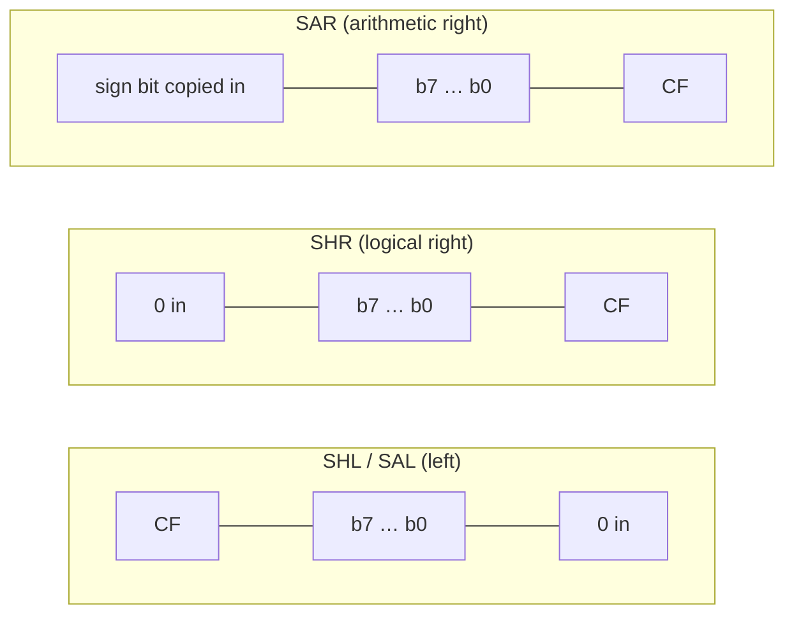

## Logic instructions

| Instruction | Operation | Typical use |
|---|---|---|
| `AND d, s` | bitwise AND | **clear** bits (mask with 0) |
| `OR d, s` | bitwise OR | **set** bits (mask with 1) |
| `XOR d, s` | bitwise exclusive OR | **toggle** bits; `xor ax, ax` clears AX |
| `NOT d` | invert every bit | one's complement (flags unchanged) |
| `TEST d, s` | AND, result discarded | check bits before a jump |

AND, OR, XOR and TEST always **clear CF and OF** and set ZF, SF, PF from the result.

```asm
and al, 0Fh        ; keep low nibble:   1011 0110 → 0000 0110
or  al, 80h        ; set bit 7:         0000 0110 → 1000 0110
xor al, 0FFh       ; toggle all bits    (same as NOT, but sets flags)
test al, 01h       ; is bit 0 set?  ZF = 0 if yes
jz  is_even
```

### Truth table

| A | B | A AND B | A OR B | A XOR B |
|---|---|---|---|---|
| 0 | 0 | 0 | 0 | 0 |
| 0 | 1 | 0 | 1 | 1 |
| 1 | 0 | 0 | 1 | 1 |
| 1 | 1 | 1 | 1 | 0 |

## Shifts

The count is `1` or the register **CL** on the 8086 (`shl ax, 3` needs an 80186+).



| Instruction | Effect | Arithmetic meaning |
|---|---|---|
| `SHL d, 1` / `SAL` | bits move left, 0 enters at bit 0, old MSB → CF | × 2 |
| `SHR d, 1` | bits move right, 0 enters at MSB, old LSB → CF | ÷ 2 unsigned |
| `SAR d, 1` | bits move right, sign bit kept | ÷ 2 signed (rounds toward −∞) |

```asm
mov al, 00000101b   ; 5
shl al, 1           ; 00001010b = 10
mov cl, 2
shl al, cl          ; 00101000b = 40   (5 × 8)
mov bl, -16         ; 0F0h
sar bl, 1           ; 0F8h = -8
```

## Rotates

| Instruction | Effect |
|---|---|
| `ROL d, n` | rotate left; MSB goes to LSB **and** CF |
| `ROR d, n` | rotate right; LSB goes to MSB **and** CF |
| `RCL d, n` | rotate left **through** CF (9- or 17-bit rotate) |
| `RCR d, n` | rotate right through CF |

## Example: print AL in binary

```asm
      mov bl, al          ; value to print
      mov cx, 8           ; 8 bits
print_bit:
      shl bl, 1           ; MSB → CF
      mov dl, '0'
      adc dl, 0           ; DL = '0' + CF  → '0' or '1'
      mov ah, 02h         ; DOS: print character in DL
      int 21h
      loop print_bit
```

## Sources

- Intel, *The 8086 Family User's Manual* (1979), ch. 2 — Bit Manipulation Instructions — [archive.org](https://ia801302.us.archive.org/2/items/bitsavers_intel80869lyUsersManualOct79_62967963/9800722-03_The_8086_Family_Users_Manual_Oct79.pdf)
- Wikipedia, *Bitwise operation* — [en.wikipedia.org/wiki/Bitwise_operation](https://en.wikipedia.org/wiki/Bitwise_operation)
- Wikipedia, *Circular shift* — [en.wikipedia.org/wiki/Circular_shift](https://en.wikipedia.org/wiki/Circular_shift)
- WSU EE314, *x86 instruction reference* — [eecs.wsu.edu](https://eecs.wsu.edu/~ee314/handouts/x86ref.pdf)
