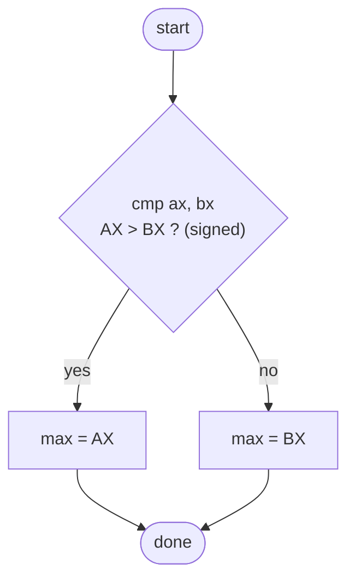

Normally the CPU runs instructions in order because IP is incremented after each fetch (see the
[instruction cycle](../processor/instruction-cycle.html)). **Transfer-of-control** instructions load
a new value into IP (and sometimes CS) instead.

## JMP: unconditional

```asm
      jmp done          ; always go to label 'done'
      ...
done:
```

| Kind | Range | Changes |
|---|---|---|
| short | −128 … +127 bytes | IP |
| near | anywhere in the same segment | IP |
| far | another segment | CS and IP |

## CMP + conditional jump

`CMP a, b` subtracts `b` from `a` and only sets flags; the next **Jcc** jumps if a condition holds.
On the 8086 conditional jumps are **short** (±127 bytes).

| Condition | Unsigned | Signed | Flags tested |
|---|---|---|---|
| a = b | `JE` / `JZ` | `JE` / `JZ` | ZF = 1 |
| a ≠ b | `JNE` / `JNZ` | `JNE` / `JNZ` | ZF = 0 |
| a > b | `JA` / `JNBE` | `JG` / `JNLE` | unsigned: CF=0 & ZF=0 · signed: ZF=0 & SF=OF |
| a ≥ b | `JAE` / `JNB` / `JNC` | `JGE` / `JNL` | CF=0 · SF=OF |
| a < b | `JB` / `JNAE` / `JC` | `JL` / `JNGE` | CF=1 · SF≠OF |
| a ≤ b | `JBE` / `JNA` | `JLE` / `JNG` | CF=1 or ZF=1 · ZF=1 or SF≠OF |

Single-flag jumps: `JS`/`JNS`, `JO`/`JNO`, `JP`/`JNP` (`JPE`/`JPO`), `JC`/`JNC`.

:::tip
**A**bove/**B**elow = unsigned; **G**reater/**L**ess = signed. `mov al, 0FFh` / `cmp al, 1`: `JA` jumps (255 > 1) but `JG` does not (−1 < 1).
:::

## if / else



```asm
      cmp ax, bx
      jle else_part      ; opposite condition jumps to else
      mov max, ax        ; then-part
      jmp endif
else_part:
      mov max, bx
endif:
```

## Loops

`LOOP label` does `CX = CX − 1` and jumps if CX ≠ 0 (no flags changed).

| Instruction | Jumps when |
|---|---|
| `LOOP` | CX ≠ 0 |
| `LOOPE` / `LOOPZ` | CX ≠ 0 **and** ZF = 1 |
| `LOOPNE` / `LOOPNZ` | CX ≠ 0 **and** ZF = 0 |
| `JCXZ` | CX = 0 (use it to skip a loop when the count is 0) |

### for loop: print 10 stars

```asm
      mov cx, 10
      jcxz skip          ; guard: LOOP with CX = 0 would run 65,536 times
star: mov dl, '*'
      mov ah, 02h
      int 21h
      loop star
skip:
```

### while loop: sum 1 + 2 + … until the sum exceeds 100

```asm
      xor ax, ax         ; sum
      xor bx, bx         ; i
while_top:
      cmp ax, 100
      ja  while_end      ; while (sum <= 100)
      inc bx
      add ax, bx
      jmp while_top
while_end:               ; AX = 105, BX = 14
```

## Sources

- Intel, *The 8086 Family User's Manual* (1979), ch. 2, Program Transfer Instructions, [archive.org](https://ia801302.us.archive.org/2/items/bitsavers_intel80869lyUsersManualOct79_62967963/9800722-03_The_8086_Family_Users_Manual_Oct79.pdf)
- Wikipedia, *FLAGS register*, [en.wikipedia.org/wiki/FLAGS_register](https://en.wikipedia.org/wiki/FLAGS_register)
- WSU EE314, *x86 instruction reference*, [eecs.wsu.edu](https://eecs.wsu.edu/~ee314/handouts/x86ref.pdf)
- K. Irvine, *Assembly Language for x86 Processors*, ch. 6 “Conditional Processing”.
