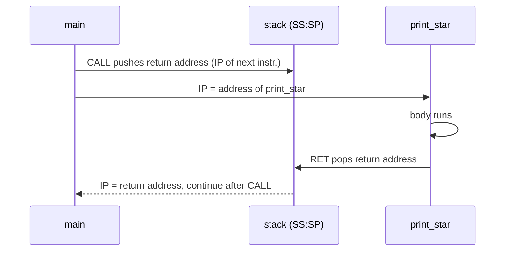

The **stack** was introduced earlier as a last-in-first-out area used by procedure calls
([Program Segments](../registers-memory/memory-segmentation.html#program-segments)) and the **SP**
and **BP** registers that point into it. This page shows how to use them.

## How the stack works

- The stack lives in the **stack segment**: top of stack = `SS:SP`.
- It **grows downward**: `PUSH` first decrements SP by 2, then stores the word.
- `POP` reads the word at `SS:SP`, then increments SP by 2.

:::widget stack-visualizer
Interactive stack — PUSH values and POP them into AX to watch SP move.
:::

```asm
push ax       ; save AX
push bx       ; save BX
; ... use AX and BX freely ...
pop  bx       ; restore in REVERSE order
pop  ax
```

## CALL and RET



| Instruction | Near (same segment) | Far (other segment) |
|---|---|---|
| `CALL proc` | push IP, IP = target | push CS, push IP, CS:IP = target |
| `RET` | pop IP | pop IP, pop CS (`RETF`) |
| `RET n` | pop IP, then SP = SP + n (discard n bytes of parameters) | |

## A complete example

```asm
.model small
.stack 100h
.data
msg db 'Sum = $'
.code
main proc
    mov ax, @data
    mov ds, ax

    mov ax, 25
    mov bx, 17
    call add_nums        ; result in AX = 42

    push ax              ; keep result while printing the message
    mov ah, 09h
    lea dx, msg
    int 21h
    pop ax
    call print_num       ; prints 42

    mov ax, 4C00h
    int 21h
main endp

; add_nums: AX = AX + BX
add_nums proc
    add ax, bx
    ret
add_nums endp

; print_num: print unsigned AX in decimal
print_num proc
    push ax
    push bx
    push cx
    push dx
    mov bx, 10
    xor cx, cx           ; digit counter
divide:
    xor dx, dx
    div bx               ; AX = AX / 10, DX = remainder (next digit)
    push dx              ; digits come out in reverse — stack fixes the order
    inc cx
    test ax, ax
    jnz divide
show:
    pop dx
    add dl, '0'
    mov ah, 02h
    int 21h
    loop show
    pop dx
    pop cx
    pop bx
    pop ax
    ret
print_num endp
end main
```

## Passing parameters on the stack (BP frame)

```asm
    push 5          ; parameter 2  (80186+; on an 8086: mov ax, 5 / push ax)
    push 7          ; parameter 1
    call multiply   ; result in AX = 35
    ; RET 4 in the callee already removed the parameters

multiply proc
    push bp
    mov  bp, sp      ; BP now gives fixed access to this frame
    mov  ax, [bp+4]  ; parameter 1 (7)   — [bp+2] is the return address
    mul  word ptr [bp+6] ; × parameter 2 (5)
    pop  bp
    ret  4           ; return and drop 4 bytes of parameters
multiply endp
```

| Address | Contents (after `mov bp, sp`) |
|---|---|
| `[bp+6]` | parameter 2 (5) |
| `[bp+4]` | parameter 1 (7) |
| `[bp+2]` | return address (IP) |
| `[bp+0]` | caller's saved BP |

Because addressing with BP uses **SS** by default (see [Addressing Modes](../assembly-basics/addressing-modes.html)), `[bp+4]` reads straight from the stack.

## Sources

- Intel, *The 8086 Family User's Manual* (1979), ch. 2 — stack implementation, CALL/RET — [archive.org](https://ia801302.us.archive.org/2/items/bitsavers_intel80869lyUsersManualOct79_62967963/9800722-03_The_8086_Family_Users_Manual_Oct79.pdf)
- Wikipedia, *Call stack* — [en.wikipedia.org/wiki/Call_stack](https://en.wikipedia.org/wiki/Call_stack)
- K. Irvine, *Assembly Language for x86 Processors*, ch. 5 “Procedures” and ch. 8 “Advanced Procedures”.
