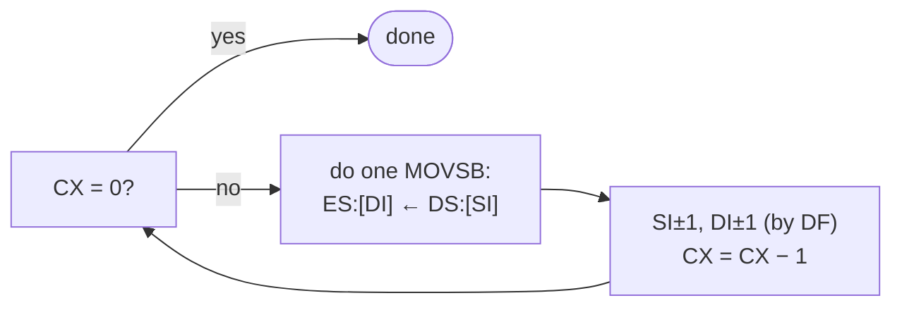

**SI** pairs with **DS** and **DI** pairs with **ES** in string manipulation (see
[Index Register](../registers-memory/types-of-registers.html#index-register)). String instructions
use exactly those registers and move through memory one byte or word at a time.

## The five string instructions

| Instruction | Byte / word form | Operation |
|---|---|---|
| `MOVS` | `MOVSB` / `MOVSW` | `ES:[DI] ← DS:[SI]`, then advance SI and DI |
| `CMPS` | `CMPSB` / `CMPSW` | compare `DS:[SI]` with `ES:[DI]` (sets flags), advance both |
| `SCAS` | `SCASB` / `SCASW` | compare AL/AX with `ES:[DI]`, advance DI |
| `LODS` | `LODSB` / `LODSW` | `AL/AX ← DS:[SI]`, advance SI |
| `STOS` | `STOSB` / `STOSW` | `ES:[DI] ← AL/AX`, advance DI |

“Advance” means **+1/+2 if DF = 0** (`CLD`, forward) or **−1/−2 if DF = 1** (`STD`, backward).

:::diagram movsb
MOVSB copies a byte from DS:SI to ES:DI and steps both pointers
:::

## Repeat prefixes

| Prefix | Repeats while | Use with |
|---|---|---|
| `REP` | CX ≠ 0 | MOVS, STOS (and LODS) |
| `REPE` / `REPZ` | CX ≠ 0 and ZF = 1 (still equal) | CMPS, SCAS |
| `REPNE` / `REPNZ` | CX ≠ 0 and ZF = 0 (not found yet) | CMPS, SCAS |

Each repetition decrements CX.



## Example 1 — copy a string

```asm
.data
src  db 'ASSEMBLY'
dst  db 8 dup(?)
.code
    mov ax, @data
    mov ds, ax
    mov es, ax          ; both strings are in the data segment
    lea si, src
    lea di, dst
    mov cx, 8
    cld                 ; forward
    rep movsb           ; dst = 'ASSEMBLY'
```

## Example 2 — fill a buffer

```asm
    lea di, dst
    mov al, '-'
    mov cx, 8
    cld
    rep stosb           ; dst = '--------'
```

## Example 3 — find a character (length of a `$`-string)

```asm
.data
text db 'COAL rocks$'
.code
    mov ax, @data
    mov es, ax
    lea di, text
    mov al, '$'
    mov cx, 0FFFFh      ; search limit
    cld
    repne scasb         ; stop when ES:[DI-1] = '$'
    ; DI now points one byte past '$'
    lea ax, text
    sub di, ax
    dec di              ; DI = 10 = length without '$'
```

## Example 4 — compare two strings

```asm
    lea si, str1
    lea di, str2        ; ES must point to str2's segment
    mov cx, 5
    cld
    repe cmpsb          ; continue while bytes are equal
    je  same            ; ZF = 1 → all 5 bytes matched
    ; different: SI-1 / DI-1 point at the first mismatch
```

:::warning
Always set DF explicitly with `CLD` or `STD` right before string instructions. Its value persists
until changed, so a routine that leaves DF = 1 can break code that runs later.
:::

## Sources

- B. Howard, *Assembly tutorial — string instructions* — [ic.unicamp.br](https://www.ic.unicamp.br/~celio/mc404s2-03/bhoward_tutorial/asmtut7.html)
- R. Hyde, *The Art of Assembly Language*, ch. 15 “Strings and Character Sets” — [cs.yale.edu](https://www.cs.yale.edu/flint/cs422/doc/art-of-asm/pdf/CH15.PDF)
- Intel 80386 Programmer's Reference, §3.6 String and Character Translation — [css.csail.mit.edu](https://css.csail.mit.edu/6.5660/2013/readings/i386/s03_06.htm)
- Intel 80386 Programmer's Reference, *MOVS* — [scs.stanford.edu](https://www.scs.stanford.edu/nyu/04fa/lab/i386/MOVS.htm)
