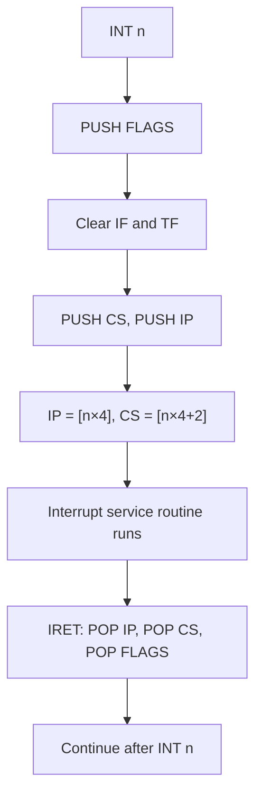

The [8085 page](../microprocessors/8085.html#interrupt-control) defines an interrupt as a request
that temporarily diverts the processor to handle an urgent event. The 8086 extends this to **256
interrupt types** that share one mechanism.

## Kinds of interrupts

| Kind | Source | Examples |
|---|---|---|
| Hardware (external) | a device raises the INTR or NMI pin | keyboard, timer (INT 08h), NMI (INT 02h) |
| Software | the `INT n` instruction | `int 21h` (DOS), `int 10h` (BIOS video) |
| Exceptions (internal) | the CPU itself | divide error (INT 00h), single-step (INT 01h, when TF = 1), overflow (`INTO`, INT 04h) |

`IF` (interrupt-enable flag) masks **INTR** only: `CLI` clears it, `STI` sets it. NMI cannot be masked.

## The interrupt vector table (IVT)

The first 1 KB of memory (`0000:0000` – `0000:03FF`) holds 256 **vectors**, 4 bytes each (offset, then segment). The vector for type *n* is at address `n × 4`.

```text
int 21h  →  vector at 21h × 4 = 0084h  →  [0000:0084] = handler IP, [0000:0086] = handler CS
```

:::diagram ivt
Each interrupt type has a 4-byte vector holding the handler’s IP and CS
:::

## What `INT n` does



## DOS services — INT 21h

Put the function number in **AH**, other inputs in the listed registers, then `int 21h`.

| AH | Function | Input | Output |
|---|---|---|---|
| 01h | read a character (with echo) | — | AL = character |
| 02h | write a character | DL = character | — |
| 08h | read a character (no echo) | — | AL = character |
| 09h | write a `$`-terminated string | DS:DX = string address | — |
| 0Ah | buffered line input | DS:DX = buffer (byte 0 = max length) | byte 1 = chars read |
| 2Ah | get system date | — | CX = year, DH = month, DL = day |
| 4Ch | terminate program | AL = return code | — |

### Example: read a key and echo it in uppercase

```asm
.model small
.stack 100h
.data
ask db 'Press a letter: $'
nl  db 0Dh, 0Ah, '$'
.code
main proc
    mov ax, @data
    mov ds, ax
    mov ah, 09h
    lea dx, ask
    int 21h
    mov ah, 01h          ; read key → AL
    int 21h
    mov bl, al
    mov ah, 09h
    lea dx, nl
    int 21h
    cmp bl, 'a'
    jb  show
    cmp bl, 'z'
    ja  show
    sub bl, 20h          ; lowercase → uppercase
show:
    mov dl, bl
    mov ah, 02h
    int 21h
    mov ax, 4C00h
    int 21h
main endp
end main
```

## BIOS services

| Interrupt | AH | Function |
|---|---|---|
| INT 10h | 00h | set video mode (AL = mode, e.g. 03h = 80×25 text) |
| INT 10h | 02h | set cursor position (BH = page, DH = row, DL = column) |
| INT 10h | 0Eh | teletype output of AL |
| INT 16h | 00h | wait for key: AH = scan code, AL = ASCII |
| INT 1Ah | 00h | read system timer ticks (CX:DX) |

## Port-mapped I/O

DOS/BIOS calls are convenient, but hardware is ultimately reached through **I/O ports** with `IN` and
`OUT` (see [Data Transfer](../instruction-set/data-transfer.html#port-i-o-in-out)). For example, on a PC
the keyboard controller's data port is 60h and the PC speaker is controlled through port 61h.

## Sources

- Intel, *The 8086 Family User's Manual* (1979) — interrupts and the interrupt pointer table — [archive.org](https://ia801302.us.archive.org/2/items/bitsavers_intel80869lyUsersManualOct79_62967963/9800722-03_The_8086_Family_Users_Manual_Oct79.pdf)
- UMBC CMSC 211, *INT 21h functions* — [csee.umbc.edu](https://www.csee.umbc.edu/courses/undergraduate/CMSC211/fall01/burt/tech_help/int21.html)
- UMBC CMSC 211, *BIOS and DOS interrupts* — [courses.cs.umbc.edu](https://courses.cs.umbc.edu/undergraduate/CMSC211/fall02/burt/tech_help/BIOSandDOS_Interrupts.html)
- R. Duncan, *MS-DOS Functions* (1988) — [bitsavers mirror](https://ftp.mirrorservice.org/sites/www.bitsavers.org/pdf/microsoft/msdos_3.3/Duncan_-_MS-DOS_Functions_1988.pdf)
- Wikipedia, *DOS API* — [en.wikipedia.org/wiki/DOS_API](https://en.wikipedia.org/wiki/DOS_API)
- Wikipedia, *Interrupt vector table* — [en.wikipedia.org/wiki/Interrupt_vector_table](https://en.wikipedia.org/wiki/Interrupt_vector_table)
