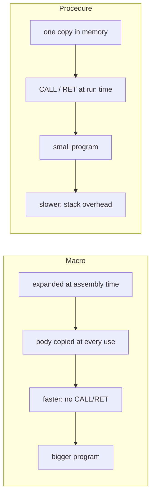

A **macro** is a named block of source text. Wherever you write the macro's name, the assembler
**expands** it, copying the body into your program with the parameters substituted. Nothing happens
at run time: there is no CALL or RET.

## Defining and using a macro

```asm
; ---- definitions (place before use) ----
print macro text            ; 'text' is a parameter
    lea dx, text
    mov ah, 09h
    int 21h
endm

exit_dos macro code
    mov ah, 4Ch
    mov al, code
    int 21h
endm

; ---- program ----
.model small
.stack 100h
.data
hello db 'Hello from a macro!$'
.code
main proc
    mov ax, @data
    mov ds, ax
    print hello             ; expands to the three lines of the macro
    exit_dos 0
main endp
end main
```

## LOCAL labels

A label inside a macro would be defined twice if the macro is used twice. Declare it `LOCAL` and the
assembler generates a unique name (`??0000`, `??0001`, …) for each expansion:

```asm
abs_ax macro
    local positive
    test ax, ax
    jns positive
    neg ax
positive:
endm
```

## Macro vs. procedure



| | Macro | Procedure |
|---|---|---|
| When processed | assembly time | run time |
| Code size | grows with every use | one copy |
| Speed | no call overhead | CALL/RET + pushes |
| Parameters | text substitution | registers or stack |
| Best for | short, frequently used sequences (print, exit) | longer routines |

## Macro libraries

Put your macros in a file, e.g. `io.inc`, and include it in any program:

```asm
include io.inc
```

## Sources

- Microsoft Learn, *MASM Directives reference, Macros (MACRO, LOCAL, ENDM)*, [learn.microsoft.com](https://learn.microsoft.com/en-us/cpp/assembler/masm/directives-reference)
- HelpPC 2.10, *Macro Assembler Directives*, [panthema.net](https://panthema.net/2006/helppc21/HelpPC-2.10-HTML/asm-directives.html)
- Intel, *MCS-86 Macro Assembly Language Reference Manual* (1979), [bitsavers mirror](https://ftp.mirrorservice.org/sites/www.bitsavers.org/pdf/intel/ISIS_II/9800640-02_MCS-86_Macro_Assembly_Language_Manual_Sep79.pdf)
- K. Irvine, *Assembly Language for x86 Processors*, ch. 10 “Structures and Macros”.
