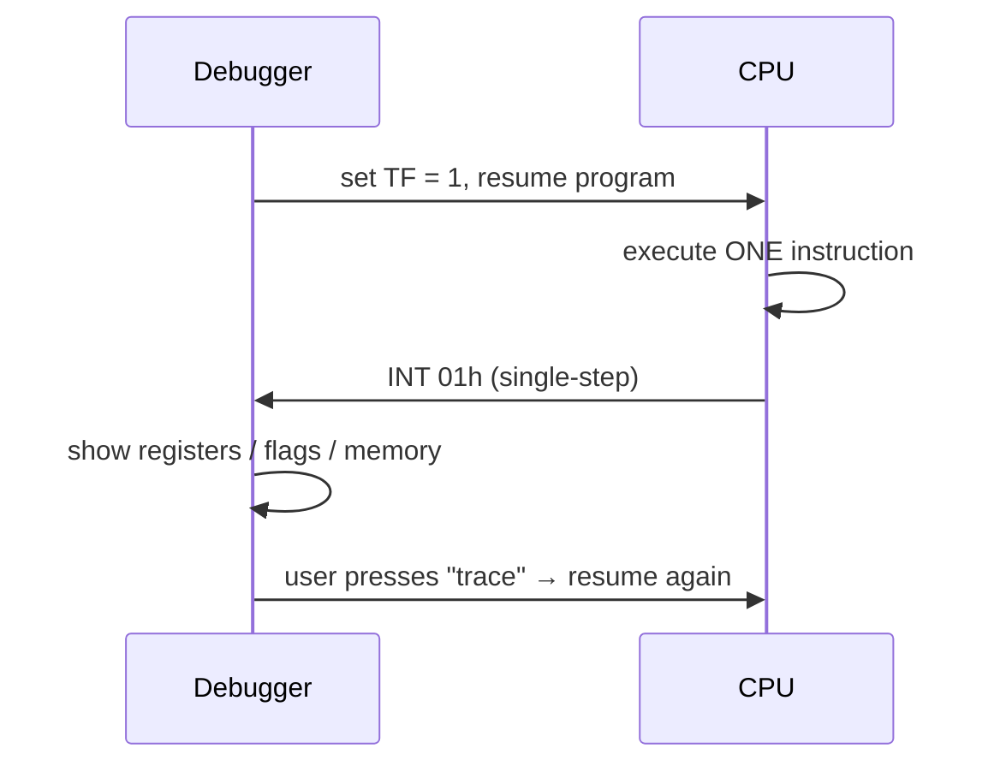

## Tools for 8086 programs

| Tool | What it is | Good for |
|---|---|---|
| **emu8086** | 8086 emulator + assembler with register/memory/flag windows | classroom work, single stepping |
| **DOSBox** | DOS emulator for modern systems | running real MASM/TASM, LINK, DEBUG |
| **MASM / TASM** | Microsoft / Borland assemblers | producing .OBJ files |
| **DEBUG** | DOS's built-in debugger | inspecting memory and registers, tracing |
| **Turbo Debugger / CodeView** | full-screen debuggers for TASM / MASM | source-level debugging |

## How a debugger single-steps

The 8086 **trap flag (TF)** from the [flag register](../registers-memory/types-of-registers.html#flag-register)
makes the CPU raise interrupt 01h after every instruction. A debugger sets TF, and its INT 01h
handler shows you the registers before letting the next instruction run.



## DOS DEBUG — essential commands

| Command | Meaning | Example |
|---|---|---|
| `R` | show/change registers | `R`, `R AX` |
| `T` | trace one instruction (into calls/INTs) | `T` |
| `P` | proceed (step over CALL/INT/LOOP) | `P` |
| `G` | go (run), optionally to an address | `G 0115` |
| `U` | unassemble (disassemble) | `U 100` |
| `D` | dump memory | `D DS:0000` |
| `E` | enter bytes into memory | `E 200 41 42 43` |
| `A` | assemble instructions at an address | `A 100` |
| `Q` | quit | `Q` |

```text
C:\> debug hello.exe
-r                      (look at CS:IP, DS, SS:SP)
-u                      (see your first instructions)
-t                      (execute mov ax,@data …)
-d ds:0                 (dump the data segment after mov ds,ax)
-g                      (run to the end)
-q
```

## The most common mistakes

| Symptom | Likely cause | Fix |
|---|---|---|
| Garbage printed, then hang | forgot `mov ax, @data` / `mov ds, ax` | initialise DS first |
| String prints forever | missing `'$'` terminator | end strings with `'$'` |
| “Divide overflow” | DX not cleared before `div bx`, or quotient too big | `xor dx, dx` / `cwd` |
| Loop runs 65,536 times | CX was 0 when `LOOP` started | guard with `jcxz` |
| Registers corrupted after a CALL | procedure didn't save/restore them | `push` at entry, `pop` in reverse order |
| Program crashes on return | unbalanced PUSH/POP inside a procedure | every PUSH needs a POP before RET |
| “Operand types must match” | mixed sizes, e.g. `mov al, bx` | use the same size or `byte ptr`/`word ptr` |
| Wrong result with negative numbers | used `JA`/`MUL` instead of `JG`/`IMUL` | pick signed vs. unsigned instructions deliberately |
| `FFFFh` “undefined symbol” | hex constant begins with a letter | write `0FFFFh` |

## Sources

- Wikipedia, *DEBUG (DOS command)* — [en.wikipedia.org/wiki/Debug_(command)](https://en.wikipedia.org/wiki/Debug_(command))
- DOSBox project — [dosbox.com](https://www.dosbox.com/)
- Intel, *The 8086 Family User's Manual* (1979) — trap flag and single-step interrupt — [archive.org](https://ia801302.us.archive.org/2/items/bitsavers_intel80869lyUsersManualOct79_62967963/9800722-03_The_8086_Family_Users_Manual_Oct79.pdf)
- KFUPM COE 205, *Some Basic Interrupts* — [faculty.kfupm.edu.sa](https://faculty.kfupm.edu.sa/COE/shazli/coe205/Help/interrupts.html)
